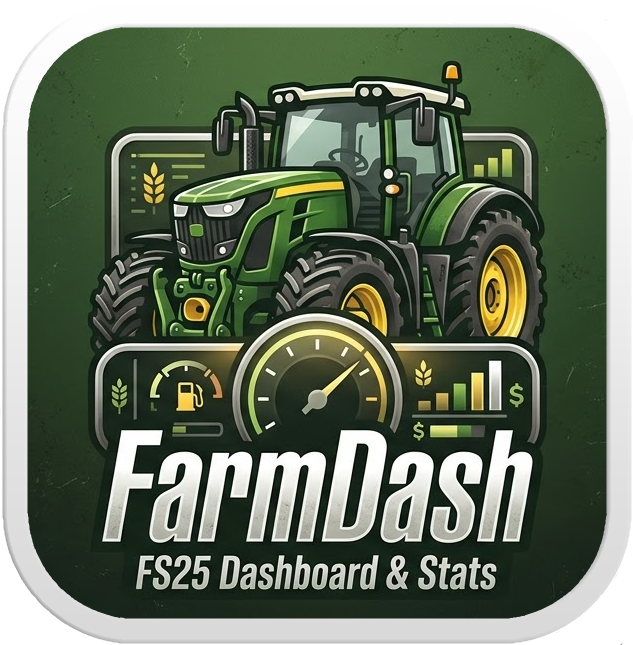

# FarmDash



A local web dashboard for **Farming Simulator 25** that reads your save files in real time and displays farm stats in your browser.

  

## Features

- **Overview** — farm name, map, current day, time & weather
- **Fields** — crop type, growth stage, weed/spray/lime status for every field
- **Vehicles** — owned machines with damage, dirt level and fuel
- **Weather** — full forecast from the save file
- **Crop prices** — buy prices per season with trend indicators
- **Storage** — current inventory across all silos and storage buildings
- Auto-refresh on a configurable interval (default 30 s)

## Quick start (Windows .exe)

1. Download `FarmDash.exe` from the [latest release](../../releases/latest)
2. Place it anywhere (e.g. your Desktop)
3. Run `FarmDash.exe` — a browser tab opens at `http://localhost:9988`
4. Paste the path to your FS25 saves folder, for example:
   ```
   C:\Users\YourName\Documents\My Games\FarmingSimulator2025
   ```
5. Click **Save configuration**, then pick a save game from the list

> `config.json` is created next to the `.exe` and stores your settings between runs.

## Running from source

**Requirements:** Python 3.12+, Node.js 20+

```bash
# 1. Install Python dependencies
pip install -r requirements.txt

# 2. Build the Vue frontend
cd app
npm install
npm run build
cd ..

# 3. Start the server
python main.py
# Opens http://localhost:9988 automatically
```

**Frontend dev mode** (hot-reload, requires backend running separately):
```bash
cd app
npm run dev
```

## How it works

FarmDash is a FastAPI server that parses FS25 XML save files on every request and returns the data as JSON. The Vue 3 SPA is bundled into `api/static/` and served directly by the Python process — no separate web server needed.

```
FS25 saves folder
  └── savegame1/
        careerSavegame.xml  →  overview (name, map, date)
        farms.xml           →  money
        fields.xml          →  field status & crops
        vehicles.xml        →  machinery
        environment.xml     →  weather & day/time
        economy.xml         →  crop buy prices
        storages.xml        →  silo inventory
```

The save folder path is configured once via the UI and stored in `config.json`. The dashboard auto-refreshes the active tab at the configured interval.

## Building the .exe yourself

The release is built automatically via GitHub Actions on every published release. To build locally:

```bash
pip install pyinstaller
cd app && npm ci && npm run build && cd ..
python -c "from PIL import Image; img = Image.open('icon.png'); img.save('icon.ico', format='ICO', sizes=[(256,256),(64,64),(32,32),(16,16)])"
pyinstaller --onefile --name FarmDash --noconsole ^
  --icon icon.ico ^
  --add-data "icon.png;." ^
  --add-data "api\static;api\static" ^
  --collect-all uvicorn ^
  --collect-all starlette ^
  --collect-all pystray ^
  --collect-all tkinter ^
  --hidden-import fastapi ^
  --hidden-import anyio ^
  --hidden-import anyio._backends._asyncio ^
  --hidden-import pystray._win32 ^
  --hidden-import PIL ^
  --hidden-import PIL.Image ^
  --hidden-import tkinter.filedialog ^
  main.py
```

Output: `dist/FarmDash.exe`
